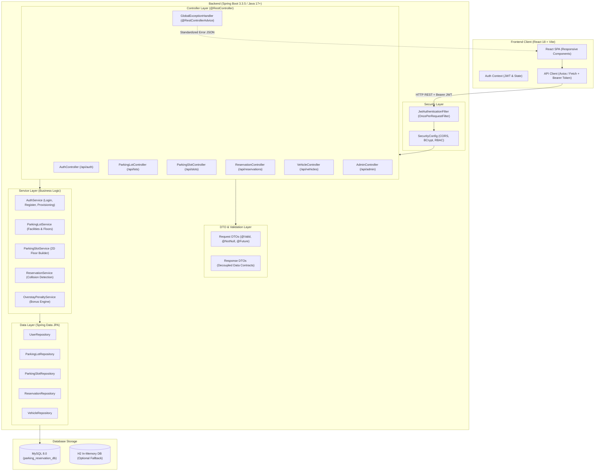
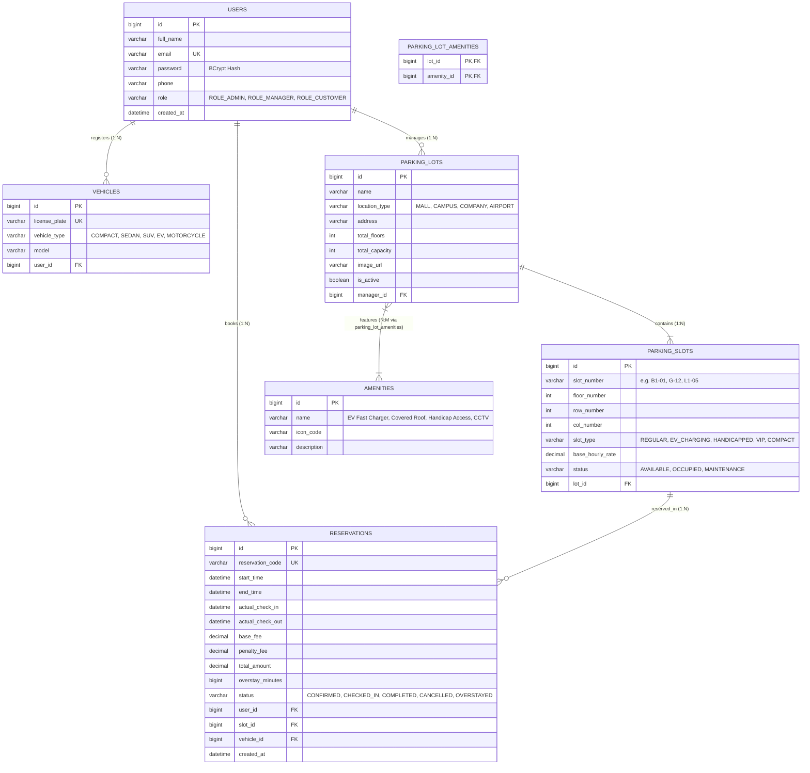

# 🚗 ParkPulse — Smart Parking Slot Reservation System
### *Multi-Role Enterprise Parking Management Platform for Malls & Campuses*

[](https://www.oracle.com/java/)
[](https://spring.io/projects/spring-boot)
[](https://spring.io/projects/spring-data-jpa)
[](https://www.mysql.com/)
[](https://react.dev/)
[](https://vitejs.dev/)
[](https://spring.io/projects/spring-security)
[-success.svg)](https://junit.org/junit5/)

---

## 📌 1. Project Overview & Domain

* **Project Title:** **ParkPulse** *(Smart Parking Slot Reservation System)*
* **Domain:** Travel & Transport / Smart City Infrastructure
* **Difficulty Level:** Intermediate (Decoupled Full-Stack Architecture)
* **What is Built:** A full-stack web platform enabling drivers to reserve parking bays by time in shopping malls and university campuses, interact with an **interactive 2D bus-booking-style floor bay selector**, check in/out digitally, and automatically compute **overstay penalties** upon late departure.
* **Role Hierarchy:**
  1. **🛡️ System Administrator (`ROLE_ADMIN`):** Full control over all facilities, registers new malls/decks, provisions manager accounts with assigned facilities and initial passwords, and monitors global revenue and penalty metrics.
  2. **🏬 Parking Lot Manager (`ROLE_MANAGER`):** Provisioned exclusively by Admin (cannot self-register). Manages their assigned facility, creates floors (B1, Ground, Level 1...), adds 2D parking bays, toggles maintenance, and handles front-desk arrival check-in/out.
  3. **🚗 Customer / Driver (`ROLE_CUSTOMER`):** Can self-register publicly. Browses facilities, selects bays on the 2D floor grid, reserves time-based slots, adds vehicles, presents digital passes, and checks in/out.
* **Unified Portal Login:** All 3 roles share a **single, unified login page** (`/login`). The application automatically redirects each authenticated user to their respective role-specific dashboard.

---

## 🏛️ 2. System Architecture

ParkPulse follows a strict **Layered Enterprise Architecture** with decoupled contracts:



---

## 🗄️ 3. Database Schema & Entity-Relationship (ER) Diagram

The database structure satisfies and exceeds all evaluation requirements with **at least 3–4 related tables featuring both 1:N and N:M relationships**:



### Relationship Breakdown
1. **$1:N$ Relationships:**
   * `USERS` $\to$ `VEHICLES`: One customer can register multiple vehicles (Sedan, EV, SUV).
   * `USERS` $\to$ `RESERVATIONS`: One user can create multiple time-based reservations.
   * `PARKING_LOTS` $\to$ `PARKING_SLOTS`: One facility contains multiple slots distributed across floors.
   * `PARKING_SLOTS` $\to$ `RESERVATIONS`: One parking bay accommodates sequential bookings over time.
   * `USERS (Manager)` $\to$ `PARKING_LOTS`: One manager can be assigned to manage facilities.
2. **$N:M$ Relationship:**
   * `PARKING_LOTS` $\leftrightarrow$ `AMENITIES`: Connected through the relational join table `parking_lot_amenities(lot_id, amenity_id)`. (A mall features EV charging, covered roof, and CCTV; an amenity belongs to multiple facilities).

---

## 🌟 4. Signature Bonus Feature: Automated Overstay Penalty Engine

### The Problem
In campus and mall parking decks, drivers frequently overstay their booked window (e.g., booking 2 hours but departing after 3.5 hours), preventing scheduled reservations from parking and causing congestion.

### The Algorithmic Solution
ParkPulse features an **Automated Overstay Penalty Engine** executed in `OverstayPenaltyServiceImpl.java` when a vehicle checks out:

1. **Grace Period Protection (15 Minutes):**
   * If the driver vacates within 15 minutes of their scheduled `end_time`, no penalty is assessed ($\text{penalty} = \$0.00$).
2. **Tiered Penalty Multiplier:**
   * If $\text{actual\_check\_out} > \text{end\_time} + 15\text{ minutes}$:
     $$\text{Overstay Duration} = \text{actual\_check\_out} - \text{end\_time}$$
     $$\text{Billable Overtime Hours} = \lceil\text{Overstay Minutes} / 60.0\rceil$$
     $$\text{Penalty Rate} = \text{Base Hourly Rate} \times 1.5$$
     $$\text{Penalty Surcharge} = \text{Billable Hours} \times \text{Penalty Rate}$$
     $$\text{Total Amount Billed} = \text{Base Fee} + \text{Penalty Surcharge}$$
3. **Audit Trail & Digital Receipt:**
   * Updates reservation status to `OVERSTAYED`.
   * Records exact `overstay_minutes` and generates an itemized departure receipt displaying the grace period leeway, billable overtime hours, penalty fee, and total collected.

---

## 🎯 5. Core Features Breakdown

* **Interactive 2D Bus-Style Parking Bay Selector:**
  * Displays an aerial parking stall grid per floor (B1, Ground, Level 1...).
  * Live status colors: 🟢 Available, 🔴 Occupied, 🟡 Maintenance, ⚡ EV Charging, ♿ Handicap Accessible, ⭐ VIP.
  * Direct bay click opens the booking modal with live price estimation.
* **Double-Booking Collision Prevention Query:**
  * Uses JPA SQL overlap detection before confirming any reservation:
    $$\text{Conflict exists if: } (\text{RequestedStart} < \text{ExistingEnd}) \land (\text{RequestedEnd} > \text{ExistingStart})$$
* **Role-Based Provisioning by Admin:**
  * Only Admins can create and provision `PARKING_LOT_MANAGER` accounts with passwords and assigned malls.
* **Check-In & Check-Out Workflow:**
  * Check-In locks the bay to `OCCUPIED` and records arrival time.
  * Check-Out frees the bay back to `AVAILABLE` and triggers the penalty calculation engine.
* **Search, Filter & Pagination:**
  * Full server-side pagination with Spring Data `Pageable` across slots, facilities, and reservations.

---

## 🚀 6. Step-by-Step Setup & Execution

### Prerequisites
* **Java 17 or higher** (Tested with Java 25 LTS)
* **MySQL 8.0** running locally on port 3306 (or H2 in-memory profile)
* **Node.js v18+ & npm**

### A. Database Setup (MySQL)
1. Ensure the MySQL service is running.
2. The database `parking_reservation_db` will be created automatically, or create it manually:
   ```sql
   CREATE DATABASE IF NOT EXISTS parking_reservation_db CHARACTER SET utf8mb4;
   ```
3. Credentials in `backend/src/main/resources/application.properties`:
   ```properties
   spring.datasource.username=root
   spring.datasource.password=root
   ```

### B. Running the Backend (Spring Boot)
1. Open a terminal in the `backend/` directory:
   ```bash
   cd backend
   ```
2. Start the application using the Maven Wrapper:
   ```bash
   # Windows PowerShell / CMD:
   .\mvnw.cmd spring-boot:run

   # Linux / macOS:
   ./mvnw spring-boot:run
   ```
3. *(Optional)* To run with **H2 In-Memory Database** (zero setup required):
   ```bash
   .\mvnw.cmd spring-boot:run -Dspring-boot.run.profiles=h2
   ```
4. The backend starts at `http://localhost:8080`. Sample data seeds automatically on the first boot!

### C. Running the Frontend (React + Vite)
1. Open a new terminal in the `frontend/` directory:
   ```bash
   cd frontend
   npm run dev
   ```
2. Open your browser at `http://localhost:5173`.

---

## 🔑 7. Pre-Configured Test Accounts

| Role | Email Address | Password | Permissions & Dashboard |
| :--- | :--- | :--- | :--- |
| **🛡️ System Administrator** | `admin@parkpulse.com` | `password123` | Provision managers, add facilities, global metrics, overstay audit |
| **🏬 Mall Manager** | `manager.mall@parkpulse.com` | `password123` | Add floors, 2D bay builder, arrivals check-in desk, maintenance toggle |
| **🚗 Customer** | `customer@parkpulse.com` | `password123` | 2D bay selector, time-based booking, digital passes, vehicle management |

---

## 🧪 8. Unit Testing & Quality Assurance

* Minimum requirement: 5 JUnit tests for service layer.
* **ParkPulse includes 12 comprehensive JUnit 5 + Mockito unit tests** covering:
  1. `OverstayPenaltyServiceTest` — On-time exit, 15-min grace period waiver, 1.5x penalty calculation.
  2. `ReservationServiceTest` — Happy path booking, collision overlap detection, check-in state transitions.
  3. `ParkingSlotServiceTest` — 2D grid builder, duplicate bay number rejection, floor map formatting.
  4. `AuthServiceTest` — Customer registration with BCrypt hashing, duplicate email rejection.

To run all unit tests:
```bash
cd backend
.\mvnw.cmd test
```
**Result:** `Tests run: 12, Failures: 0, Errors: 0, Skipped: 0 — BUILD SUCCESS`

---

## 📬 9. Postman Collection Testing

A complete Postman collection is exported in the root directory:
📂 `parking_slot_reservation_postman_collection.json`

### Endpoints Catalog

| Module | Method | Endpoint | Access | Description |
| :--- | :--- | :--- | :--- | :--- |
| **Auth** | `POST` | `/api/auth/register` | Public | Register customer account |
| **Auth** | `POST` | `/api/auth/login` | Public | **Unified Login** (returns JWT & role) |
| **Auth** | `GET` | `/api/auth/me` | Authenticated | Get current authenticated user profile |
| **Lots** | `GET` | `/api/lots` | Public | List all active parking facilities |
| **Lots** | `GET` | `/api/lots/{id}/slots/map` | Public | Get **2D Floor Slot Map** (bus-style) |
| **Lots** | `POST` | `/api/lots/{id}/floors` | Manager/Admin | Add new floor to facility |
| **Slots** | `GET` | `/api/slots` | Authenticated | **Search, Filter & Paginate** slots |
| **Slots** | `POST` | `/api/slots` | Manager/Admin | Add parking bay to 2D grid |
| **Slots** | `PATCH` | `/api/slots/{id}/status` | Manager/Admin | Toggle maintenance / available |
| **Vehicles**| `POST` | `/api/vehicles` | Customer | Register customer vehicle |
| **Vehicles**| `GET` | `/api/vehicles/my` | Customer | List my vehicles |
| **Bookings**| `POST` | `/api/reservations` | Authenticated | Book slot with collision check |
| **Bookings**| `GET` | `/api/reservations/my` | Customer | My reservations (Paginated) |
| **Bookings**| `POST` | `/api/reservations/{id}/check-in` | Authenticated | Check-in vehicle |
| **Bookings**| `POST` | `/api/reservations/{id}/check-out`| Authenticated | **Check-out & Overstay Penalty** |
| **Admin** | `POST` | `/api/admin/managers` | Admin Only | **Provision Mall Manager ID & Password**|
| **Admin** | `GET` | `/api/admin/stats` | Admin Only | System revenue & penalty analytics |

---

## 🎓 10. Viva Voce Defense & Knowledge Guide

Prepare for your viva examination with these module-by-module explanations:

### Q1: What is the layered design pattern and why is it used?
> **Answer:** The project follows a strict three-tier architecture:
> $$\text{Controller} \longrightarrow \text{Service} \longrightarrow \text{Repository}$$
> * **Controller Layer (`@RestController`):** Handles HTTP requests, performs input validation (`@Valid`), and returns ResponseEntity with appropriate HTTP status codes. Controllers never access the database directly.
> * **Service Layer (`@Service`):** Contains pure business logic (e.g. collision detection, fee calculation, overstay penalty formulas, and transactions).
> * **Repository Layer (`@Repository`):** Extends Spring Data `JpaRepository` to interface with the database using Hibernate ORM.
> This separation enhances testability (mocking dependencies with Mockito), maintainability, and code reusability.

### Q2: How do you prevent double-booking for the same parking bay?
> **Answer:** In `ReservationRepository.java`, we implement a collision detection query that detects any temporal overlap:
> ```sql
> WHERE r.slot.id = :slotId 
>   AND r.status IN ('CONFIRMED', 'CHECKED_IN')
>   AND (:startTime < r.endTime AND :endTime > r.startTime)
> ```
> If any record matches, the `ReservationService` throws a custom `SlotConflictException`, which is caught by `@RestControllerAdvice` and returned as an HTTP 409 Conflict response.

### Q3: How is password security and authentication implemented?
> **Answer:** 
> 1. Passwords are never stored in plaintext. They are hashed using `BCryptPasswordEncoder` with 10 salt rounds.
> 2. Authentication uses **Stateless JSON Web Tokens (JWT)**. Upon successful login at `POST /api/auth/login`, the backend signs a cryptographic HMAC-SHA256 token containing the user's ID and role claim.
> 3. For subsequent requests, the React frontend attaches the token in the `Authorization: Bearer <token>` header. The `JwtAuthenticationFilter` intercepts the request, validates the signature, extracts the user details, and sets the `SecurityContext`.

### Q4: How is the Many-to-Many ($N:M$) relationship modeled in JPA?
> **Answer:** The $N:M$ relationship between `ParkingLot` and `Amenity` is configured using `@ManyToMany` and `@JoinTable`:
> ```java
> @ManyToMany(fetch = FetchType.LAZY)
> @JoinTable(
>     name = "parking_lot_amenities",
>     joinColumns = @JoinColumn(name = "lot_id"),
>     inverseJoinColumns = @JoinColumn(name = "amenity_id")
> )
> private Set<Amenity> amenities = new HashSet<>();
> ```
> Hibernate automatically creates and maintains the junction table `parking_lot_amenities`.

### Q5: How does the Overstay Penalty calculation work?
> **Answer:** When a customer checks out at `POST /api/reservations/{id}/check-out`:
> 1. It compares `actualCheckOutTime` against the booked `endTime`.
> 2. If the vehicle exits within the configured 15-minute grace period (`app.parking.grace-period-minutes=15`), the penalty is waived ($\$0.00$).
> 3. Beyond 15 minutes, the engine computes overtime hours using ceiling rounding (`Math.ceil(minutes / 60.0)`).
> 4. The penalty surcharge is computed at $1.5\times$ the slot's hourly rate and appended to the base fee, changing the reservation status to `OVERSTAYED`.

---

## 📜 License & Integrity Notice
This project was designed for educational evaluation, adhering strictly to institutional academic integrity guidelines. Renamed and custom-branded as **ParkPulse**.
